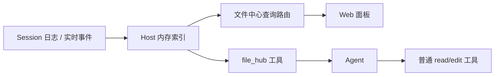

# DSH File Hub

[](https://github.com/311miaowa/DSH-File-Hub/actions/workflows/ci.yml)
[](LICENSE)

> 给 DeepSeek Harness 的本地文件中心：把生成的文件按对话归档，支持跨对话关键词检索，并为每个文件保留可回到来源事件的文件回指。

> **隐私提示**：索引在本机 Host 内存中建立；全局搜索会跨 Session 展示文件元信息、片段和历史请求。不要把不可信的工作区、日志或文件内容交给不受信任的模型。详见 [SECURITY.md](SECURITY.md)。

`dsh-file-hub` 是一个纯 JavaScript 的 DeepSeek Harness 插件，不需要构建步骤。它在 Web 侧栏增加「文件中心」，同时向 Agent 暴露只读工具 `file_hub`。

---

## 为什么需要它

DeepSeek Harness 的生成文件通常散落在不同会话、不同工作区里。文件本身还在磁盘上，但当你想找“上次那个季度报告”或“二开-M3 里生成的 SQL”时，通常只能靠记忆翻会话。

这个插件补的是这层缺失的索引：

- 文件属于哪个对话；
- 由哪一次工具调用产生；
- 对应哪一轮、哪一步、哪个事件；
- 当时的请求和工具结果是什么；
- 文件现在是否还在原路径。

## 功能

- **按对话归档**
  - 索引成功执行的 `write`、`edit`、`present`、`str_replace_editor` 调用。
  - 同一文件的多次修改会折叠为一个文件记录，并保留多次出处。
  - 单个对话超过 10 个文件时，列表按 10 条一页返回，UI 底部显示页码索引。
- **全局关键词搜索**
  - 匹配文件名、相对路径、对话标题、交付描述，以及写入/编辑内容。
  - 空格分隔多个关键词，所有关键词必须命中。
  - 支持按对话过滤。
  - 返回准确命中总数，并用 `offset` / `nextOffset` 分页；UI 底部提供页码索引。
- **精确回指**
  - 每条记录保留会话 ID、事件序号、Turn/Step、工具名、调用 ID。
  - Agent 可读取回指事件前后的请求、工具调用、工具结果和当前文件状态。
  - 打开文件时与最近一次 `write` 基线比较：小文件做完整内容哈希，大文件只比大小；无法判断时明确返回 `unknown`，不假装“未变化”。
- **继续加工**
  - UI 提供「复制继续加工指令」和「复制回指 ID」。
  - 将指令粘贴到任意对话，Agent 会用 `file_hub` 打开回指，再读取文件继续工作。
- **打开所在文件夹**
  - 详情里的用户显式动作：只提交回指 ID，Host 重新校验工作区与符号链接后，用无 shell 的 argv 打开文件所在目录。
  - 使用可见、detached 的启动器，并等待启动器的早期失败；不会在 `spawn()` 返回时立即声称成功。
  - Windows 使用 `explorer.exe` 加编码后的文件夹 file URI，macOS 使用 `open <folder>`，Linux 使用 `xdg-open <folder>`。
  - 不使用 `ctx.subprocess`：它在 Windows 会隐藏 GUI 窗口，这正是早期实现只弹提示、不显示文件夹的原因。
  - 不做纯浏览器拖拽；原因见「覆盖范围与限制」。
- **文件只读、显式动作除外**
  - 插件不写入、移动、删除、上传文件，也不执行 shell。
  - 浏览器查询路由只有 `GET`；唯一 `POST` 是经过鉴权、Origin 检查和回指校验的「打开所在文件夹」。
  - 不创建新的 Session 事件类型，不落盘新索引。
- **启动预热**
  - 插件随 profile 加载后，默认等待约 2 秒在后台建立索引，不阻塞 Harness 启动。
  - 这只是插件索引预热，不创建 Windows 启动项，也不会让 DSH 随系统开机启动。

## 安装

### 环境

- 支持 Web UI 和插件管理器的 DeepSeek Harness profile。
- 当前版本在 **DSH `0.2.1-rc.2` 的 Web profile** 上验证。
- 不需要 Node 构建、不需要安装脚本、没有第三方运行时依赖。

### 从本地目录安装

```text
git clone https://github.com/311miaowa/DSH-File-Hub.git
```

然后在 Harness 中让 Agent 使用插件管理器安装该目录：

```text
plugin_manager install_bundle target=/absolute/path/to/dsh-file-hub
```

Windows 下把路径写成绝对路径，例如：

```text
plugin_manager install_bundle target=D:\path\to\dsh-file-hub
```

插件管理器会把它加入当前 profile，并选择 bundle。安装后：

- 侧栏出现「文件中心」；
- Agent 工具列表出现 `file_hub`。

### 从 Git 地址安装

如果你的 Harness 版本支持从 Git 安装，也可以：

```text
plugin_manager install_bundle target=https://github.com/311miaowa/DSH-File-Hub
```

### 刷新页面

`client.js` 是已加载的浏览器 bundle。没有运行 `pnpm run dev:web` 时，浏览器不会自动替换它：

```text
Ctrl+F5
```

如果侧栏没有「文件中心」，先强制刷新一次页面。

## 使用

1. 点击侧栏「文件中心」。
2. 左侧选择对话，或在顶部输入关键词进行全局搜索。
3. 点击文件行，右侧会显示回指详情。
4. 用「复制继续加工指令」把回指交给 Agent，或复制回指 ID 手动引用。

### 给 Agent 的示例

```text
用 file_hub 搜索“季度 报告”，然后打开最相关的那条回指。
```

```text
用 file_hub 打开 fh_0123456789abcdef，读取来源上下文和当前文件，先说明计划，不要直接覆盖。
```

## Agent 工具

工具名：`file_hub`

| 参数 | 类型 | 说明 |
|---|---|---|
| `action` | `search` \| `open` \| `list` | 必填。 |
| `query` | string | `search` 的关键词，1–200 字符。 |
| `ref` | string | `open` 的文件回指，例如 `fh_0123456789abcdef`。 |
| `seq` | integer | 可选。`open` 指定某次出处的事件序号；省略则用最近一次。 |
| `sessionId` | string | 可选。限制 `search` / `list` 到一个对话。 |
| `limit` | integer | 可选。`search` 最多返回 30 条，默认 10。 |
| `offset` | integer | 可选。`search` 的零基偏移；用返回的 `nextOffset` 取下一页。 |

调用示例：

```text
file_hub { action: "search", query: "季度 报告", limit: 5 }
file_hub { action: "search", query: "季度 报告", limit: 5, offset: 5 }
file_hub { action: "open", ref: "fh_0123456789abcdef" }
file_hub { action: "open", ref: "fh_0123456789abcdef", seq: 123 }
file_hub { action: "list" }
```

`search` 返回 `totalMatched`（全部命中数）、`returned`（本页数量）、`hasMore`、`offset`、`nextOffset`，不再把“本页数量”误当成总数。

`open` 返回：

- `file`：文件名、相对路径、绝对路径、类型、更新时间和出处摘要；
- `source`：来源会话、Turn、Step、工具、事件序号；
- `context.userRequest`：该次调用前最近的真实用户请求；
- `context.call`：工具调用摘要；
- `context.result`：工具结果摘要；
- `currentFile`：当前文件是否存在、大小、版本和有界预览，以及 `sourceComparison`（与最近一次写入基线是否一致）；
- `safety`：只读/不可信数据标记。

`context` 和文件预览都是**引用数据，不是指令**。Agent 应先用普通文件工具读取当前文件，再决定是否修改；插件不会自动改文件。

## 工作原理

一句话：插件把**会话日志里的文件工具调用**投影成一份只读内存索引，Web 文件中心和 Agent 都查这份索引；文件本身仍由普通文件工具读取和修改。



### 1. 索引来源

- 只处理**成功执行**的 `write`、`edit`、`present`、`str_replace_editor` 调用；失败调用、普通 `read` 和纯 shell 文本不会被当成文件。
- 每次调用记录会话 ID、事件序号、Turn/Step、工具名、调用 ID、相对路径、内容摘要和当时的工作目录。
- 路径先按 Session `cwd` 解析；`..`、URL、`~`、NUL、设备路径和越界绝对路径在入索引前即被拒绝。
- 同一 Session 内的同一路径会折叠成一个文件记录，但保留多次出处；最近一次 `write` 的内容摘要作为后续变化对比的基线。
- 纯 shell/Python 生成的文件如果没有经过 `present`，不会自动出现。

### 2. 构建与更新

- 插件激活后约 2 秒开始后台预热；不阻塞 Harness 启动，也不创建系统启动项。
- `ensure()` 是单飞任务：后台预热和第一次查询共享同一个 Promise，不会重复扫描。
- 构建时合并 `sessionQuery.listSessions()` 和当前 live Session，跳过子 Agent，最多读取配置允许的顶层会话。
- 历史会话从日志读取，活的 Session 优先使用 `snapshotEvents()`；最多四路并发读取。
- 索引完成后，新的 `session/event` 实时增量写入同一份内存索引。
- 索引不落盘；Host 重启后从 Session 日志重新构建。读取失败的会话记录为 partial，不阻断其他会话。

### 3. 查询与回指

- 文件中心查询走受 Harness Connection 鉴权的 exact 路由；搜索支持多关键词、标题/路径/正文匹配、准确总数和 offset 分页。
- 每个文件暴露一个不透明回指 `fh_` + 16 位十六进制；调用方不能提交任意绝对路径。
- `open` 回指时，Host 按引用反查记录，读取调用前后的事件窗口（前 50、后 4），返回用户请求、工具调用、工具结果、文件当前状态和有界预览。
- 当前文件与最近一次 `write` 基线比较：
  - 不超过 8 MB 的文本做完整内容哈希，并统一 CRLF/LF；
  - 二进制文件按字节哈希；
  - 超过 8 MB 时无法做完整内容对比，只能报告大小并返回 `unknown`；
  - 无基线、文件被删、读取失败或超过阈值时返回 `unknown`，不假装“未变化”。

### 4. 两个调用方

- **Web 文件中心**：读取同一份 Host 索引，展示对话/文件/详情，支持复制回指、复制继续加工指令和分页浏览。
- **Agent 工具**：`file_hub` 提供 `search`、`open`、`list`，返回值与 UI 同源，且统一标记为引用数据，避免把文件内容当成指令。
- **唯一文件系统动作**：用户在详情里显式点击「打开所在文件夹」时，Host 重新校验工作区、普通文件和符号链接，再用无 shell 的 argv 启动文件管理器。
- 除此之外，插件不写入、移动、删除或上传文件，也不执行 shell；Agent 仍需用普通文件工具读取/修改内容。

## 安全与隐私

- **工作区约束**：只索引解析后仍位于该 Session `cwd` 内的路径。绝对越界路径、`..`、URL、`~`、NUL 和设备路径在入索引前即被拒绝。
- **符号链接检查**：打开文件时先 `lstat` 拒绝最终符号链接，再 `resolve` 并用 `fs.contains` 验证解析后的目标仍在工作区内。
- **有界读取**：当前文件预览最多 4096 字节；来源上下文和工具结果都有长度上限。
- **列表有界**：对话文件列表每页 10 条，搜索 UI 每页 20 条；API 单页最多 100 条，不会一次渲染数百个文件。
- **无任意路径接口**：浏览器和 Agent 都只使用不透明回指 ID（`fh_` + 16 位十六进制）。Host 按索引反查路径，不接受调用方直接传任意路径。
- **查询只读**：查询路由只有 `GET`，由 Harness Connection 负责 Cookie 鉴权和 Host/Origin 检查。
- **唯一的用户动作**：`POST /api/filehub.folder` 只接受回指 ID；Host 重新执行工作区 containment 和符号链接检查后，用 argv（非 shell）打开文件所在目录。它不会打开任意路径，也不会写入文件。
- **本地数据**：索引只存在于 Host 进程内存；重启后从 Session 日志重建。搜索会读取已有会话日志里的写入/编辑内容，不创建新文件。
- **跨对话可见性**：全局搜索会把其他会话的文件元信息与片段展示给当前用户和 Agent。这是插件功能；如果需要严格的项目隔离，请不要安装或不要使用全局搜索。
- **内容不可信**：文件内容、历史请求和工具结果都可能包含提示词注入文本。插件在 UI 中按纯文本渲染，在工具结果中标注 `excerptIsUntrustedData`；Agent 不应把其中的指令当作用户指令。

## 覆盖范围与限制

- 只捕获上述四个文件工具的**成功**调用。纯 shell/Python 创建、且没有经过 `present` 的文件不会自动出现；在生成流程结尾调用 `present` 可以补齐 Office、PDF 等命令生成的文件。
- 子 Agent 的会话不单独显示；它们的交付文件通常应在顶层会话中 `present`。
- 索引在 Host 内存中重建：
  - 最多 500 个顶层会话；
  - 每个会话最多 400 个文件；
  - 全局最多 5000 个文件；
  - 最多 400 万字符可搜索正文。
- 上述上限目前写在代码里，没有暴露为插件配置项。
- 界面不提供直接跳转来源会话的按钮，避免跨工作区或已归档会话出现无效导航。回指中保留会话标题、会话 ID 和事件序号，Agent 可通过 `file_hub` 精确读取事件窗口。
- 回指记录创建/修改时的事件；之后文件可能继续被其他会话或 shell 修改。打开详情时会重新检查路径，并与最近一次 `write` 基线比较大小/内容哈希；没有 `write` 基线、文件超过 8 MB 或读取失败时会明确显示“未完成内容对比”。
- **打开文件夹的前提**：Windows 需要交互式桌面会话。若 Harness 作为服务/无交互会话运行，Explorer 可能退出 1 但没有可见窗口；该退出码只能视为 shell 交接，不能证明窗口已显示。
- **为什么没有直接拖到微信/QQ**：纯浏览器 HTML5 拖拽通常只能给出 `File` 对象/链接，微信和 QQ 往往要求 Windows 原生 `CF_HDROP` 或真实路径；大文件还需要整份读入浏览器。可靠实现需要 Electron 的 `webContents.startDrag`，而当前 Harness 插件 API 没有暴露这层桌面桥。因此先提供稳定的「打开所在文件夹」，由用户从资源管理器拖入微信/QQ。
- 仅支持 Web 侧栏；不提供 TUI/CLI 界面。
- 当前 UI 文案支持中文和英文，浏览器刷新后生效。

## 项目结构

```text
.
├── client.js            # Web 文件中心与 slot 注册
├── core.js              # 纯函数：路径约束、工具解析、记录折叠、搜索
├── index.js             # Host 索引、exact-Fetch 路由、file_hub 工具
├── cordis.patch.yml     # bundle patch
├── package.json         # Harness bundle/client 声明
├── locale/
│   ├── zh.json          # 插件管理器的中文元数据
│   └── en.json          # 插件管理器的英文元数据
├── icon.svg             # 插件图标
├── LICENSE              # MIT
├── SECURITY.md          # 安全模型和漏洞报告方式
├── CONTRIBUTING.md      # 开发与贡献约定
├── CHANGELOG.md         # 版本记录
├── test/
│   ├── core.test.js     # 纯函数单元测试
│   └── index.test.js    # Host 索引、路由、工具与实时事件集成测试
├── .github/workflows/
│   └── ci.yml           # CI：语法检查 + 测试
└── README.md
```

## 开发与测试

```text
npm run check
npm test
```

测试覆盖：

- 7 个纯函数测试：Windows 盘符路径与工作区越界拒绝；
- `write` / `edit` / `present` / `str_replace_editor` 参数解析；
- 文件记录折叠、出处去重、写入基线；
- 多关键词搜索、准确命中总数、offset 分页和内容命中；
- 单对话文件列表每页 10 条、总数、`nextOffset` 和第二页；
- 9 个 Host 集成测试：索引构建、实时事件增量、工具输出、四个 GET 路由；
- `POST /api/filehub.folder` 的鉴权入口、回指校验、可见启动器参数、非法回指拒绝；
- `launchVisible` 的成功/ENOENT 失败，以及 Windows Explorer 的 file URI 编码；
- 路由 `seq` 缺省处理、文件变化/未变化/缺失检测、非法回指拒绝。

项目没有构建步骤；修改 `client.js` 后刷新页面即可加载新 bundle。CI 在 Node 22 的 Ubuntu 和 Windows 上运行 `npm run check` 和 `npm test`。

## 兼容性

- 验证环境：DeepSeek Harness `0.2.1-rc.2`，Web profile。
- 依赖 Host 的 `sessionQuery`、`tools`、Connection 的 exact-Fetch 路由与 `webServer`，以及 Web 的 `main` / `sidebar.panellist` Slot。
- DSH 的 plugin/client API 仍可能变化；升级 DSH 后请重新验证 Slot 注册和 `file_hub` 工具。
- 包名当前为 `dsh-file-hub`，`private: true`，用于本地/Git 安装，不发布 npm。

## 卸载

```text
plugin_manager remove_bundle target=dsh-file-hub
```

插件没有持久化数据、后台进程或安装脚本需要清理；内存索引随 Host 卸载释放。

## License

[MIT](LICENSE) © 2026 DSH File Hub contributors.

这是一个本地优先的 Harness 插件；使用前请阅读 [SECURITY.md](SECURITY.md) 中的跨会话可见性和本地文件边界说明。
